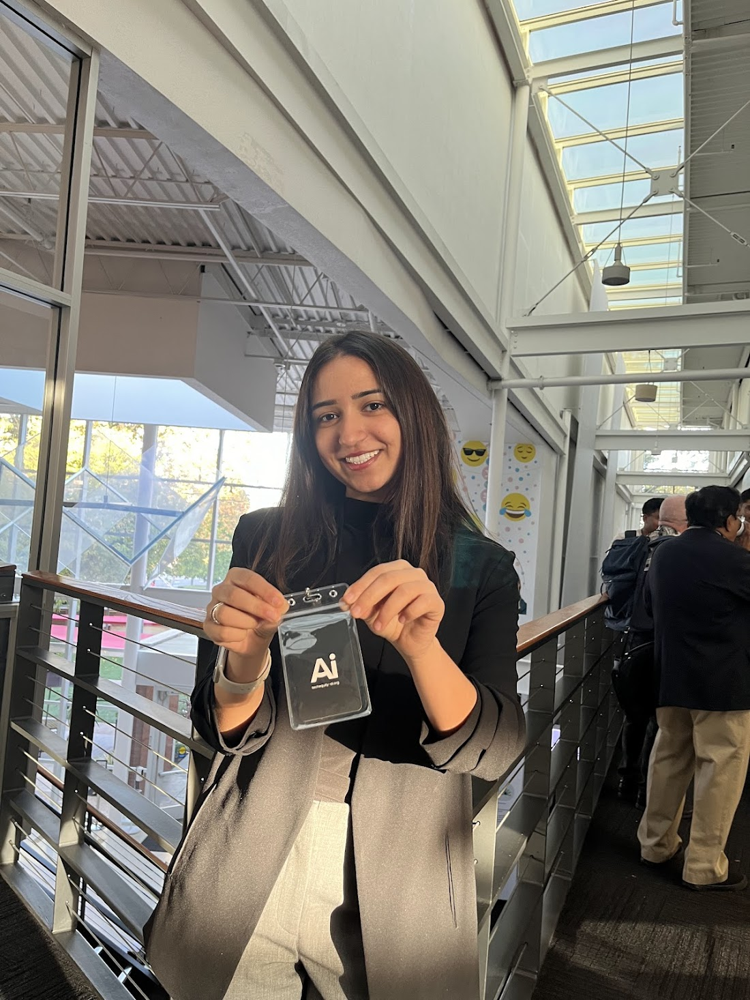

# Hi, I'm Julia! 👋
 

Welcome to my GitHub profile! I build <b>AI agents</b>, <b>backend systems</b>, and <b>data pipelines</b> that hold up in production, and I care deeply about <b>responsible AI</b>. I've shipped software at Workday, NASA Ames, and AWS, and I love turning complex, real-world challenges into reliable tools people can reliably use.

💼 <a href="https://www.linkedin.com/in/julia-husainzada/">LinkedIn</a> ✉️ <a href="mailto:juliahusainzada@gmail.com">Email</a>
 
### 🌱 About Me
 
✩ <b>Data Science</b> student (Minor in Business) at <b>SJSU</b>, graduating May 2027 
✩ Former intern at <b>Workday</b>, <b>NASA Ames</b>, <b>AWS</b>, and <b>KPMG</b> 
✩ Best Overall Project, <b>SpartHill Hacks IBM AI Challenge</b> Agentic Governance Platform 
✩ Founder & President of SJSU's <b>Responsible Computing Club</b> · 300+ Members
 
 

 
## 💻 Featured Repositories
### 1. [ClearStand: Agentic AI Governance Platform (🏆 Best Overall Project, SpartHill Hacks IBM AI Challenge)](https://github.com/PA1393/IBM-Hackathon-Project)
A **multi-agent AI platform** that won Best Overall Project at SpartHill Hacks in October 2026!
- Audits applications for security, ethics, transparency, and accessibility risks using **RAG** and **LLMs**
- Detects security and policy violations in product code with a context-aware RAG pipeline over 1,800+ risk records, using **Grok** embeddings and **ChromaDB**
- Recommends code fixes prioritized by risk severity; 3x faster and more accurate than general AI assistants
### 2. [AgentPanelMatching: AI Panel Builder for NASA (NASA Ames Research Center – Spring 2026)](https://github.com/juliahusainzada/AgentPanelMatching)
An **AI agent** that helps NASA Program Scientists assemble diverse, qualified review panels!
- Searches 60K+ researchers from the Astrophysics Data System (ADS) using plain-English requests, cutting panel construction from days to minutes
- Applies conflict-of-interest exclusions, career-stage minimums, and institution-type requirements (R1, R2, HBCU, HSI, non-university)
- Runs follow-up searches when constraints aren't met and returns a ranked panel with an explanation for every pick, built with **Python**, **Gemini**, and **RAG**
### 3. [Club Engagement Analytics Platform (Project Lead – Jan 2026)](https://github.com/rcc-sjsu/Dashboard-Engagement)
A **full-stack analytics platform** built with **React**, **FastAPI**, **Node.js**, and **PostgreSQL/MySQL**:
- Led a 7-person engineering team through Agile sprints in Jira, from design to delivery
- Built data ingestion pipelines and **REST APIs** to transform raw CSV/form data into analytics-ready PostgreSQL datasets
- Processes 750+ membership records and delivers engagement and retention metrics to inform membership strategy
### 4. [KPMG Machine Learning Challenge Project (Break Through Tech AI Program)](https://github.com/KPMG1A/AI-Studio-Project)
Check out my team's project repository for the real-world ML project we worked on for KPMG for over 3 months, as part of the Break Through Tech AI Program's Fall 2024 AI Studio!
- Analyzed 40,000+ zip codes and 3,000+ donations for C5LA using CRISP-DM framework and Agile methodology
- Achieved 88% accuracy with Random Forest model, selected features with RFE, optimized parameters with RandomizedSearchCV, applied preprocessing and trend analysis using Pandas, NumPy, Scikit-learn
- Presented findings and actionable recommendations to KPMG staff and C5LA to improve donor retention
### 5. [Equitable AI for Dermatology (Break Through Tech AI Program – Spring 2025)](https://github.com/juliahusainzada/equitable-ai-dermatology)
- Led all exploratory data analysis (EDA) for a Kaggle competition focused on building a fair computer vision model to classify skin conditions across diverse skin tones.
- Conducted fairness-driven analysis using the Fitzpatrick skin tone scale and visualized class imbalances across 21 medical skin conditions.
- Insights from my EDA guided fairness-aware model development to address bias and healthcare disparities in dermatological AI.
---
 
## 🛠️ Tools & Languages
 
**Languages**
 

 
**ML & AI**
 

 
**Software, Data & Cloud**
 

